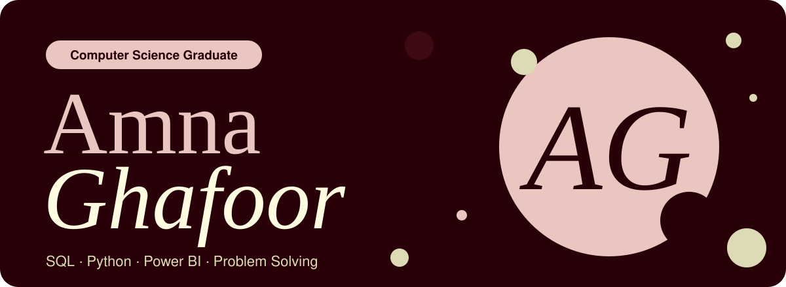
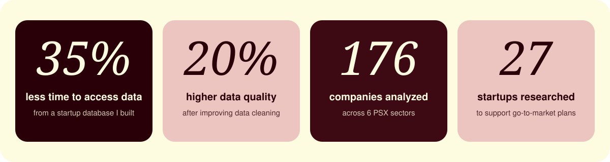

 

**I turn messy data into clear answers using SQL, Python, Excel and Power BI.**
Faisalabad, Pakistan · Open to new opportunities

  

 

## 👩‍💻 About me

I'm a Computer Science graduate from Government College University, Faisalabad (2021–2025). My internships and startup work took me from building databases to equity research. I enjoy careful work where details matter: a query that returns the right rows, a dashboard that matches its source, a problem traced back to its cause.

I learn new tools quickly and explain findings in plain language.

 

## 🛠️ Skills

<table>
<tr>
<td width="33%" valign="top">

**Code and data**

</td>
<td width="33%" valign="top">

**Analysis and reporting**

</td>
<td width="33%" valign="top">

**Business tools**

</td>
</tr>
</table>

**Ways of working:** problem solving · communication · teamwork · quick learner

 

## 💼 Experience

<table>
<tr>
<td width="22%" valign="top"><b>Oct – Nov 2025</b></td>
<td valign="top"><b>Management Trainee Officer</b>, AKD Securities Ltd. Analyzed 176 companies across 6 PSX sectors, built Excel dashboards and prepared industry reports.</td>
</tr>
<tr>
<td valign="top"><b>Apr 2025 – Present</b></td>
<td valign="top"><b>Founder, FlexiBuild</b> (She-Venture Fellow, NIC Faisalabad) Lead data-informed product strategy for a construction-tech startup.</td>
</tr>
<tr>
<td valign="top"><b>Aug – Oct 2023</b></td>
<td valign="top"><b>Data Science Intern</b>, NICF Built a startup database, improved data quality and researched 27 startups.</td>
</tr>
</table>

 

## 📊 Projects

<table>
<tr>
<td width="50%" valign="top">

**⚡ Electric Vehicle Dashboard**
Interactive Power BI dashboard of EV market data and trends.

</td>
<td width="50%" valign="top">

**🏗️ Pakistan Cement Market Report**
Sector data analysis and reporting on the cement industry.

</td>
</tr>
<tr>
<td valign="top">

**🎓 Education in Punjab**
Data-driven report on education statistics and trends.

</td>
<td valign="top">

**🏠 AI Home Construction Platform**
Data and AI platform to support construction decisions.

</td>
</tr>
<tr>
<td valign="top">

**🤖 Mock Interview Chat Bot**
AI tool for interview practice.

</td>
<td valign="top">

**🔧 Go High Level and Kajabi project**
Self-taught both platforms and used them on a project for a friend.

</td>
</tr>
</table>

👉 More detail on my [portfolio website](https://amna-ghafoor.github.io/AmnaGhafoor).

 

## 🎓 Education and certifications

- **BSc Computer Science**, Government College University, Faisalabad
- Agentic AI Bootcamp, atomcamp (2025)
- Data Science and AI Bootcamp, atomcamp (2023)
- Power BI Workshop and Data Analysis for Governance, atomcamp
- 40 Days of Python for Data Science, Codanics
- Introduction to Generative AI and Large Language Models, Google

 

 

[Email me](mailto:contact.amnaghafoor@gmail.com) · [LinkedIn](https://linkedin.com/in/amnaghafoor/) · [Portfolio](https://amna-ghafoor.github.io/AmnaGhafoor)

